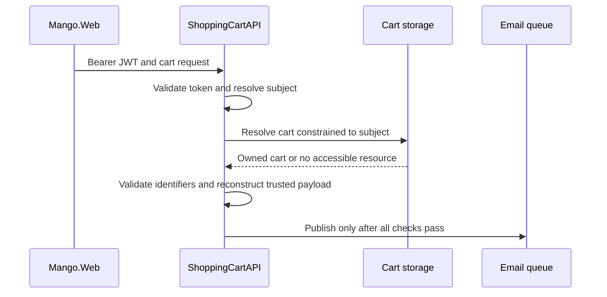

# Design

## Context

AuthAPI emits `sub`; ShoppingCart now requires JWT Bearer authorization, while the original baseline did not. Existing cart identifiers originate in routes or DTOs. `CartHeader` does not persist Name, Phone or Email, while EmailAPI consumes a CartDto with an email address. See audit SC-01 to SC-05 and archived shoppingcart baseline and error-handling changes.

## Goals / Non-Goals

**Goals:** Enforce D01-D05 at the service boundary, preserve existing route and DTO shapes where possible, and prevent writes or publication for rejected requests.

**Non-Goals:** Administrative ownership bypass, multi-item redesign, shared databases, unapproved downstream dependencies, or unrelated service hardening.

## Decisions

- D01: Require valid JWT for all five actions; resolve the stable subject from the validated principal. Test actual inbound claim mapping using issued JWTs, including missing and unusable subject. Missing identity is 401, not a resource ownership error. Avoid assuming that raw `sub` survives framework mapping unchanged.
- D02: Scope reads and mutations to the owner using persisted ownership. GetCart and ApplyCoupon return indistinguishable 404 for foreign and nonexistent carts, including body and observable response details. RemoveCart returns indistinguishable 404 for foreign and nonexistent details.
- D03: Retain DTOs and routes; never silently overwrite a mismatching supplied UserId. Invalid or malformed identifiers are 400 based on syntax alone; syntactically valid foreign or nonexistent resource references that require an existing resource are indistinguishable 404, irrespective of existence. CartUpsert creates a new cart only for a matching authenticated identity; a different well-formed UserId is rejected with 404 regardless of whether its cart exists. Set new ownership from authenticated identity. Validate supplied header/detail IDs and nested navigation objects without mapping untrusted ownership or navigation objects. Check before side effects and use ownership-constrained mutations to avoid authorization/write races.
- D04: ADMIN follows identical ownership rules.
- D05: Before publication, load the owned cart and reconstruct product, price, coupon and total using trusted persisted and existing downstream sources. The user approved the `email` claim from the validated JWT as recipient; reject publication when it is missing or unusable. Name and Phone have no approved trusted source and remain unset. Do not trust submitted items, totals, contact details or recipient. Keep the message shape needed by EmailAPI; fail closed if safe reconstruction or approved recipient is unavailable. No new cross-service dependency is authorized by this design.
- Mango.Web already sends bearer via BaseService; verify token propagation and normal flows, including handling 400/401/404. Preserve propagation to Product/Coupon and message compatibility with EmailAPI. Review CSRF and clients only as needed for these affected flows.

Alternatives: trusting DTO user IDs or ADMIN role was rejected because neither proves ownership; accepting an arbitrary client email was rejected because it permits recipient manipulation. The validated JWT email claim is approved as the recipient source; introducing an identity-service dependency has not been approved.

## Risks / Trade-offs

- Existing anonymous clients break; validate each authorized Web journey and communicate changed status codes.
- DTO fields may contain inconsistent or nested IDs; distinguish foreign and malformed cases without an existence oracle.
- GetCart and ApplyCoupon now return 404 for absent carts; this intentionally changes their existing failure behavior and must be checked with Web clients.
- Contact fields are not persisted. The approved recipient is taken from the JWT email claim; Name and Phone remain unset. No fallback to client data or publish-on-error is allowed.
- Avoid a partial cart email when Product/Coupon data cannot be trusted or resolved; fail publication closed. GetCart returns a generic HTTP 500 for propagated dependency exceptions; a missing coupon (HTTP 404) remains undiscounted.

## Open Questions

- The approved recipient is the validated JWT `email` claim; its value reflects token issuance time. No source has been approved for non-persisted Name or Phone, which remain unset for cart email. Additional recipient verification or freshness policy is not specified.

## Concurrency scope for task 4.2

The latest scope decision supersedes the earlier D07/D09/D10 concurrency implementation scope. D06 remains in this change: every update or delete in ApplyCoupon, CartUpsert and RemoveCart must be conditioned on the authenticated owner at the effective write, with affected-row checks and safe errors. These are requirements, not claims that the current implementation provides them. Missing and foreign resources retain indistinguishable 404 responses; conflict handling must not reveal ownership or raw database errors.

**ApplyCoupon:** update only a specific header selected and conditioned by its ID and authenticated owner; require one affected row. A missing or no-longer-owned row is rejected without mutation. Detect ambiguous duplicate headers without changing multiple rows.

**CartUpsert:** condition modifications of existing details on both the detail and the currently owned parent. New carts use the authenticated subject. Adding a detail to an existing header requires proving ownership at the insert itself or holding a suitably protected owner check through insertion. A previously authorized header ID or a foreign-key check alone is insufficient if ownership can change concurrently. All checks on nested references must remain valid until the write; rejection must not leave partial writes or disclose ownership.

**RemoveCart:** delete a detail only under an owner predicate and check the affected row count. Removing an empty header is also a separate owner-conditioned write and must not cascade-delete an item inserted concurrently. The detail deletion and conditional header cleanup must not leave an unauthorized or partial operation. A header ownership predicate alone does not prevent the last-item race.

**Technical gate:** Owner-conditioned writes and selective short `Serializable` transactions have been implemented. Task 4.2 remains incomplete because safe authorization, rollback and cleanup under all required concurrent interleavings have not been verified. SQL Server reported deadlock 1205 in the synchronized last-item deletion versus insertion test; a repetition timed out during transaction release or rollback. The deadlock graph was not captured, and a regression in conflict handling cannot yet be ruled out. EF Core InMemory cannot verify SQL Server transaction behavior.

**Verification status and deferral:** The isolated `Mango_ShoppingCart_Concurrency_Test` database is available. The 17 migrated tests and the deterministic tests identified in `docs/audits/shoppingcart-authorization/concurrency-verification.md` passed; the full suite passed 28 tests before the latest synchronized test was added. That last test failed, and there is no satisfactory final full-suite execution. Exhaustive concurrency verification is postponed to continue the demo, not accepted as complete. The current nullable `nvarchar(max)` UserId has no supporting index; broad locks, cascading cleanup and contention remain risks. No global Serializable, schema changes or automatic retries of non-idempotent operations are approved.

**Deferred to `harden-shoppingcart-concurrency-integrity`:** D08 unique constraints and migrations, duplicate-data investigation and remediation, atomic increments and coordination of concurrent inserts, advanced deadlock/retry strategies, and comprehensive SQL Server concurrency testing. These risks remain open: duplicate carts/details, lost increments, deadlocks and unsafe retries. The existing main spec describes one cart per user and one detail per product, but the current schema does not enforce these cardinalities. Deferral does not authorize unsafe cross-owner writes or unsafe cascades in this change. No future change has been created.

**Conflict handling:** treat zero affected rows as not found where appropriate, roll back multi-write operations on failure, and use generic server-side logging and client responses. Do not automatically retry ambiguous commits or non-idempotent increments. The exact safe transaction/conflict mechanism remains subject to approval and verification; no concurrency guarantee is asserted as verified.
## Migration Plan

Implement in scoped tasks after approval; test with real JWT handling and controlled downstream/bus fakes. Roll out coordinated with Web consumers. Synchronize OpenSpec only after verification and explicit workflow authorization.
