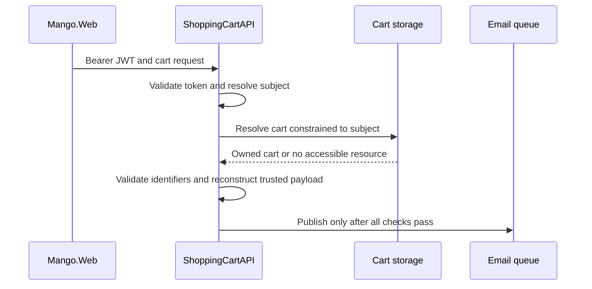

# Design

## Context

AuthAPI emits `sub`; ShoppingCart now requires JWT Bearer authorization, while the original baseline did not. Existing cart identifiers originate in routes or DTOs. `CartHeader` does not persist Name, Phone or Email, while EmailAPI consumes a CartDto with an email address. See audit SC-01 to SC-05 and archived shoppingcart baseline and error-handling changes.

The approved alternative B in `docs/audits/shoppingcart-authorization/cart-empty-contract-decision.md` revises the own-cart read contract to restore the empty view. This authorization covers planning artifacts only. The current implementation still returns 404 without a header; the behavior and tests below are requirements for later separately authorized work, not completed verification.

## Goals / Non-Goals

**Goals:** Enforce D01-D05 at the service boundary, preserve existing route and DTO shapes where possible, prevent writes or publication for rejected requests, and restore the own empty-cart journey through the approved D11 read projection without hiding errors.

**Non-Goals:** Administrative ownership bypass, multi-item redesign, shared databases, unapproved downstream dependencies, or unrelated service hardening.

## Decisions

- D01: Require valid JWT for all five actions; resolve the stable subject from the validated principal. Test actual inbound claim mapping using issued JWTs, including missing and unusable subject. Missing identity is 401, not a resource ownership error. Avoid assuming that raw `sub` survives framework mapping unchanged.
- D02: Scope reads and mutations to the owner using persisted ownership. For GetCart, reject a well-formed route identity different from the validated subject with indistinguishable 404, including body and observable response details, whether its cart exists or not; do not query foreign existence. Only a successful lookup for the validated subject that finds no header returns the D11 logical empty state. ApplyCoupon retains indistinguishable 404 for foreign and nonexistent required carts. RemoveCart retains indistinguishable 404 for foreign and nonexistent details.
- D03: Retain DTOs and routes; never silently overwrite a mismatching supplied UserId. Invalid or malformed identifiers are 400 based on syntax alone; syntactically valid foreign or nonexistent resource references that require an existing resource are indistinguishable 404, irrespective of existence. CartUpsert creates a new cart only for a matching authenticated identity; a different well-formed UserId is rejected with 404 regardless of whether its cart exists. Set new ownership from authenticated identity. Validate supplied header/detail IDs and nested navigation objects without mapping untrusted ownership or navigation objects. Check before side effects and use ownership-constrained mutations to avoid authorization/write races.
- D04: ADMIN follows identical ownership rules.
- D05: Before publication, load the owned cart and reconstruct product, price, coupon and total using trusted persisted and existing downstream sources. The user approved the `email` claim from the validated JWT as recipient; reject publication when it is missing or unusable. Name and Phone have no approved trusted source and remain unset. Do not trust submitted items, totals, contact details or recipient. Keep the message shape needed by EmailAPI; fail closed if safe reconstruction or approved recipient is unavailable. No new cross-service dependency is authorized by this design.
- D11: Return HTTP 200 for the authenticated subject's successfully established header absence, with `IsSuccess = true` and a non-null CartDto containing a non-null CartHeader (`CartHeaderId = 0`, UserId from the validated JWT, CartTotal and Discount zero) and empty non-null CartDetails. This virtual header is a read-only projection with no persisted identifier, coupon or invented contact data. No write, header creation, downstream composition call or message publication is required for that absence. Mango.Web must reject this projection in Checkout GET/POST and EmailCart with 404 before order creation or email dispatch. Real headers retain their current behavior. This decision does not alter D01-D06 or the deferred concurrency decisions except for the explicitly revised own-header absence in D02.
- Mango.Web already sends bearer via BaseService; verify token propagation and normal flows, including handling 400/401/404. Preserve propagation to Product/Coupon and message compatibility with EmailAPI. Review CSRF and clients only as needed for these affected flows.

Alternatives: trusting DTO user IDs or ADMIN role was rejected because neither proves ownership; accepting an arbitrary client email was rejected because it permits recipient manipulation. The validated JWT email claim is approved as the recipient source; introducing an identity-service dependency has not been approved.

## Risks / Trade-offs

- Existing anonymous clients break; validate each authorized Web journey and communicate changed status codes.
- DTO fields may contain inconsistent or nested IDs; distinguish foreign and malformed cases without an existence oracle.
- Alternative B changes own GetCart header absence from 404 to a logical empty 200; external clients depending on 404 need compatibility review. ApplyCoupon absent-cart and foreign-resource rejections remain 404. Changing the read result without updating Checkout/EmailCart guards would incorrectly admit a non-persisted cart to those flows.
- Contact fields are not persisted. The approved recipient is taken from the JWT email claim; Name and Phone remain unset. No fallback to client data or publish-on-error is allowed.
- Avoid a partial cart email when Product/Coupon data cannot be trusted or resolved; fail publication closed. GetCart returns a generic HTTP 500 for propagated dependency exceptions; a missing coupon (HTTP 404) remains undiscounted.

## Open Questions

- The approved recipient is the validated JWT `email` claim; its value reflects token issuance time. No source has been approved for non-persisted Name or Phone, which remain unset for cart email. Additional recipient verification or freshness policy is not specified.

## Approved logical empty-cart contract and implementation boundary

Apply authentication and syntactic validation before reading. A valid foreign route identity is rejected before querying whether its cart exists, including for ADMIN. A route identity derived from the MVC cookie that differs from the validated bearer subject remains rejected; an empty result must never be used to reconcile identity mismatch.

Only a successful owner-scoped storage query returning no header produces the D11 projection. A storage exception remains a generic HTTP 500. No Product/Coupon lookup is needed to compose a state with no persisted header; this is not recovery from a failed dependency. If a real header exists, even without details, preserve its existing product/coupon composition, zero-item presentation, unresolved-product response and dependency failure behavior. Product/Coupon exceptions continue producing generic 500 from GetCart; CouponAPI 404 continues meaning no discount. Do not add a shortcut for real empty headers or relabel an unsuccessful response as an empty cart.

The normal successful CartService/BaseService and shared loader path already transports and deserializes this CartDto for CartIndex. The existing empty-view branch renders HTTP 200 without intercepting any 404. Keep BaseService, ResponseDto, DTO shapes, the shared loader, routes and views unchanged. Route/configuration 404, received 400/401/403/500, transport failure mapped to 502, and other existing failures retain their rejection paths; no error-message comparison or new error code is needed.

The planned production scope is two files: `Mango.Services.ShoppingCartAPI/Controllers/CartAPIController.cs` for GetCart's own-header absence branch, and `Mango.Web/Controllers/CartController.cs` for virtual-header guards. Checkout GET and POST and EmailCart must return 404 for the non-persisted `CartHeaderId = 0` projection, before rendering checkout, calling OrderService, requesting email or publishing a message. Preserve existing null/failure guards and real-header behavior. Rejecting every real header with an empty detail list would be an additional functional change and is not approved here. Do not change OrderAPI, EmailCartRequest, RemoveCart or its last-header cleanup.

After a successful last-item deletion, Remove retains its redirect to CartIndex; the following own GetCart returns the same virtual empty projection and the final browser response is 200. A rejected removal still returns its error and is not treated as successful emptying. Repeated empty GETs perform no writes or header recreation; CartUpsert remains responsible for initial persistence.

Verification must distinguish own absence from foreign existence: replace the old test equivalence between own-missing and foreign reads with a positive own-empty test and equivalence between foreign-existing and foreign-missing reads, including ADMIN and no foreign-existence query. Keep authentication, malformed/nested-ID, write ownership and email integrity tests. Add exact DTO/serialization and no-side-effect checks; normal and virtual CartIndex; successful removal followed through its redirect; virtual Checkout GET/POST and EmailCart rejection with no order/email calls; real empty-header success and dependency failure; and route/configuration 404, received 401/403, storage failure and dependency/transport errors.

These empty-contract tests must use controlled HTTP/service fakes and InMemory only where appropriate, without SQL or migrations. A mocked successful last-item deletion tests MVC navigation, not relational cleanup or transaction safety. Do not execute SQL variants of existing integration tests or task 4.2 as part of this work. The separate concurrency section below and successor trace remain unchanged.

Existing completed task entries record the earlier hardening baseline; the new D11 implementation and regression tasks remain unchecked. Strict validation of the revised planning artifacts does not complete 8.2, which also requires comparing implemented behavior to all revised scenarios.

## Concurrency scope for task 4.2

The latest scope decision supersedes the earlier D07/D09/D10 concurrency implementation scope. D06 remains in this change: every update or delete in ApplyCoupon, CartUpsert and RemoveCart must be conditioned on the authenticated owner at the effective write, with affected-row checks and safe errors. These are requirements, not claims that the current implementation provides them. Missing and foreign resources retain indistinguishable 404 responses; conflict handling must not reveal ownership or raw database errors.

**ApplyCoupon:** update only a specific header selected and conditioned by its ID and authenticated owner; require one affected row. A missing or no-longer-owned row is rejected without mutation. Detect ambiguous duplicate headers without changing multiple rows.

**CartUpsert:** condition modifications of existing details on both the detail and the currently owned parent. New carts use the authenticated subject. Adding a detail to an existing header requires proving ownership at the insert itself or holding a suitably protected owner check through insertion. A previously authorized header ID or a foreign-key check alone is insufficient if ownership can change concurrently. All checks on nested references must remain valid until the write; rejection must not leave partial writes or disclose ownership.

**RemoveCart:** delete a detail only under an owner predicate and check the affected row count. Removing an empty header is also a separate owner-conditioned write and must not cascade-delete an item inserted concurrently. The detail deletion and conditional header cleanup must not leave an unauthorized or partial operation. A header ownership predicate alone does not prevent the last-item race.

**Technical gate:** Owner-conditioned writes and selective short `Serializable` transactions have been implemented. Task 4.2 remains incomplete until bounded verification of the critical ownership, rollback, safe cleanup and conflict scenarios described below succeeds. SQL Server reported deadlock 1205 in the synchronized last-item deletion versus insertion test; a repetition timed out during transaction release or rollback. The deadlock graph was not captured, and a regression in conflict handling cannot yet be ruled out. A later synchronized same-product test also failed; its reported output did not identify the cause. These failures remain evidence pending resolution, not proof of a specific production data loss. EF Core InMemory cannot verify SQL Server transaction behavior.

**Bounded verification and status:** Reuse the existing test project and isolated `Mango_ShoppingCart_Concurrency_Test` database with verified server, instance and database, synthetic data and scoped cleanup; do not start the production Program or run migrations. Verify owner, foreign, missing and ADMIN rejection and unchanged foreign state; protected ownership during writes and insertion; rollback after a write and before commit; same-product concurrent outcomes; last-detail removal versus insertion in both relevant orders; and generic responses and verified rollback on conflicts. Resolve the outcomes of the failed synchronized tests rather than treating an arbitrary 500, deadlock or timeout as success. Release barriers and observe and await both tasks before cleanup; stop on persistent tasks, uncertain rollback or integrity loss. Use the bounded execution limits documented in `docs/audits/shoppingcart-authorization/concurrency-final-diagnosis.md`. Record actual results and their limits. This gate does not require exhaustive schedules or proof of universal deadlock absence.

The 17 migrated tests and earlier deterministic tests documented in `docs/audits/shoppingcart-authorization/concurrency-verification.md` passed, and the full suite passed 28 tests before the earlier synchronized failure. Two later pre-commit rollback tests and the duplicate-header rejection test passed. The later same-product test failed without a reported cause; there is no satisfactory final regression. The current nullable `nvarchar(max)` UserId has no supporting index; broad locks, cascading cleanup and contention remain risks. No global Serializable, schema changes or automatic retries of non-idempotent operations are approved.

**Deferred to `harden-shoppingcart-concurrency-integrity`:** global uniqueness per user and product, constraints and migrations, duplicate-data investigation and remediation, global atomic increments, coordination across all writers, index and locking optimization, advanced retries and idempotency, and comprehensive SQL Server concurrency testing. These risks remain open: duplicate carts/details, lost increments, contention, deadlocks and ambiguous commits or unsafe retries. The existing main spec describes one cart per user and one detail per product, but the current schema does not enforce these cardinalities. Deferral neither changes that specification nor claims global compliance, and does not authorize unsafe cross-owner writes, partial operations or unsafe cascades in this change. Acceptance of residual risks is proposed and requires an explicit decision; it is not automatic. No future change has been created.

**Conflict handling:** treat zero affected rows as not found where appropriate, roll back multi-write operations on failure, and use generic server-side logging and client responses. Do not automatically retry ambiguous commits or non-idempotent increments. The exact safe transaction/conflict mechanism remains subject to approval and verification; no concurrency guarantee is asserted as verified.
## Migration Plan

Implement in scoped tasks after separate approval; the current authorization is documentary only. Carry the approved empty-read result and its Web guards together, with real JWT handling and controlled downstream/bus fakes in the authorized non-SQL regression. Review external consumers depending on the previous 404 and retain existing tests for real carts and failures. Do not claim D11 implemented or validated until those tasks run. Task 4.2 and the proposed `harden-shoppingcart-concurrency-integrity` successor retain their separate scope. Roll out coordinated with Web consumers. Synchronize OpenSpec only after verification and explicit workflow authorization.
